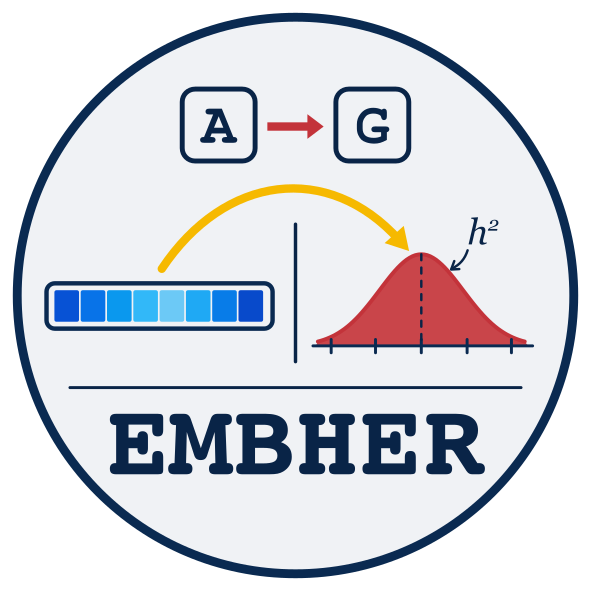
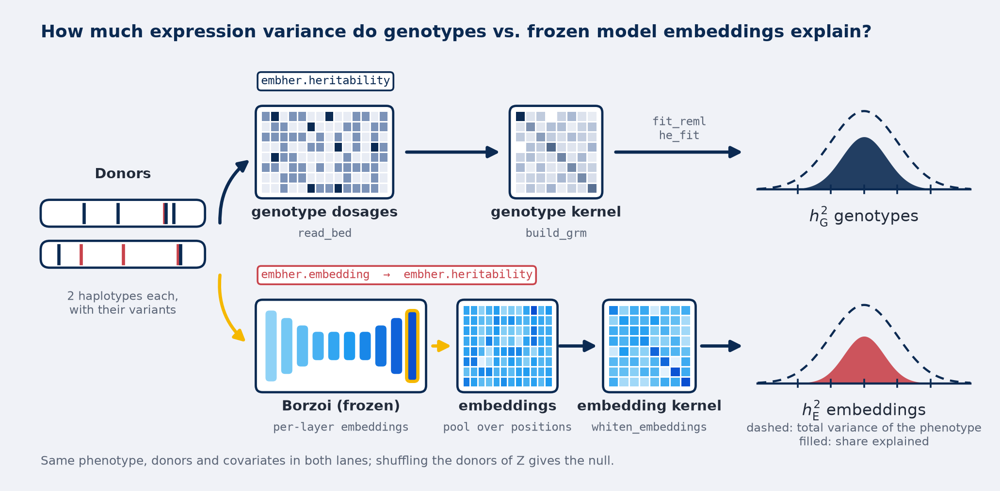

<p align="center"></p>

# embher

Two parts, installable separately:

- **`embher.heritability`**: heritability estimation from kernels (GRMs): exact multi-component AI-REML and Haseman-Elston regression, plus the helpers to build the kernels.
- **`embher.embedding`**: per-layer embedding capture and attribution for sequence-to-function models (Borzoi/Flashzoi, AlphaGenome for capture) on personal genomes, and embedding whitening.

## Install

```bash
pip install "embher @ git+ssh://git@github.com/TheBil99/EMBHER.git"                         # heritability + embedding tools
pip install "embher[capture-borzoi] @ git+ssh://git@github.com/TheBil99/EMBHER.git"         # + Borzoi/Flashzoi capture
pip install "embher[attribution] @ git+ssh://git@github.com/TheBil99/EMBHER.git"            # + attribution (implies capture-borzoi)
pip install "embher[capture-alphagenome] @ git+ssh://git@github.com/TheBil99/EMBHER.git"    # + AlphaGenome capture
```

Append `@<tag>` to the URL to pin a release. Extras combine, e.g. `embher[capture-borzoi,attribution]`.

| Install | Adds |
|---|---|
| `embher` | numpy, pandas, scipy, pyarrow, pysam, pyyaml, tqdm, h5py, ml_dtypes, numba |
| `embher[capture-borzoi]` | torch, borzoi-pytorch |
| `embher[capture-alphagenome]` | alphagenome (also jax, haiku, orbax, jmp and [alphagenome_research](https://github.com/google-deepmind/alphagenome_research), not on PyPI) |
| `embher[attribution]` | `capture-borzoi` + captum, tangermeme, decima, pyBigWig |
| `embher[all]` | `capture-borzoi`, `attribution` and `dev` (not AlphaGenome) |
| `embher[dev]` | pytest, pytest-cov |

Python >= 3.10. The Borzoi and AlphaGenome backends need disjoint stacks (torch versus jax): keep them in separate environments. Weights are not included: Borzoi/Flashzoi come from HuggingFace unless a local path is given; AlphaGenome needs a local checkpoint.

## Example



[`examples/heritability_and_embedding_demo.ipynb`](examples/heritability_and_embedding_demo.ipynb) runs on simulated data with the base install, no weights and no GPU: genotype heritability by REML and HE, then an embedding whitened and used as a kernel. A flag swaps the simulated embedding for Borzoi's (needs `capture-borzoi` and a GPU).

## Modules

| Module | Contents |
|---|---|
| `embher.heritability.reml` | genotype/kernel GRMs (`build_grm`, `bin_masks`), covariate design (`design_matrix`), exact AI-REML (`fit_reml`, optional `nonneg=True` with LRT) |
| `embher.heritability.he` | Haseman-Elston regression with delete-one jackknife (`he_fit`) |
| `embher.heritability.io` | `read_bed`: PLINK 1 `.bed` to donor x variant 0/1/2 dosage |
| `embher.heritability.grm_io` | `write_gcta_grm` |
| `embher.embedding.whiten` | `whiten_embeddings`: top-k whitened PC scores of an embedding (numpy only) |
| `embher.embedding.dataset` | `GenomeDataset`: personal genomes (needs torch, pysam) |
| `embher.embedding.capture` | capture intermediate activations to HDF5 |
| `embher.embedding.attribution` | layer-wise attribution of Borzoi windows |
| `embher.embedding.utils` | gene metadata, VCF samples, coordinates, Borzoi helpers, device selection |

The most used `heritability` functions are re-exported: `from embher.heritability import fit_reml, he_fit, build_grm, read_bed`. The base install has no torch: `heritability`, `embedding.whiten` and `embedding.utils.coordinates` import without it.

## Command-line tools (`embher.embedding.cli`)

| Command | Needs | Purpose |
|---|---|---|
| `embher-capture` | `capture-borzoi` or `capture-alphagenome` | write every intermediate and final tensor of a forward pass to HDF5 |
| `embher-attribute` | `attribution` | attribute the L2 norm of each captured layer back to the input bases (Captum input x gradient) |
| `embher-inspect-h5` | base install | check a capture file |
| `embher-prepare-gene-meta` | base install | build the gene table `embher-capture` needs from a GENCODE parquet |

```bash
embher-capture --model_type borzoi \
    --gene_meta_path genes.tsv --vcf_file_path samples.vcf.gz \
    --hg38_file_path hg38.fa --gencode_parquet gencode.annotation.gtf.parquet \
    --n_genes 5 --n_samples 10 --output_h5 out/borzoi_tensors.h5
```

`genes.tsv` needs `gene_id, chr_hg38, tss_hg38, start_hg38, end_hg38`. Arguments can also come from a YAML `--config` (with `${ENV_VAR}` expansion); CLI arguments override it. See `embher-capture --help` for reductions (pooling, output aggregation over gene/exon/intron), the HDF5 layout, `--resume` and `--embedding_layers`. `embher.embedding.cli.validate_borzoi` and `validate_alphagenome` (run with `python -m`) check that the hooked capture reproduces the model's own forward pass.

## Acknowledgements

The framework for loading personal genomes (`GenomeDataset`, `CoordinateTransformer` and the Borzoi helpers) comes from [alphagenome-personal-eval](https://github.com/mostafavilabuw/alphagenome-personal-eval) (Tu et al., Mostafavi lab). Adapted code says so in its docstring. Please cite their work if you use it:

> Xinming Tu, Anna Spiro, Maria Chikina, Sara Mostafavi. *A modality gap in personal-genome prediction by sequence-to-function model.* bioRxiv (2026). [Preprint](https://www.biorxiv.org/content/10.64898/2026.02.01.702969v1)

## Citation

If you use EMBHER, please cite:

> Federico Billeci, Miquel Anglada-Girotto, Alexander Gusev, Jonathan Frazer & Mafalda Dias. *Sequence-to-function embeddings across individuals capture rare and common variant heritability.* bioRxiv (forthcoming; DOI to be added).

The full analysis pipeline of the manuscript is at [TheBil99/EMBHER_publication](https://github.com/TheBil99/EMBHER_publication).
